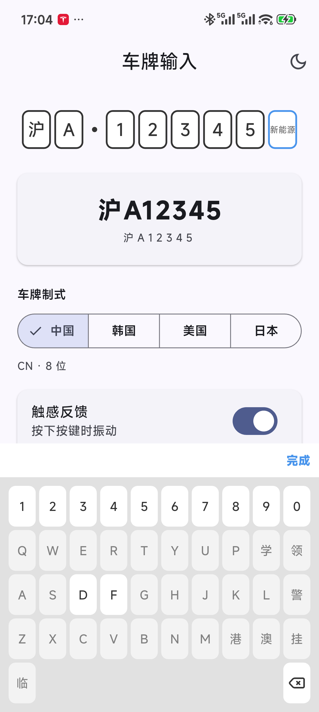
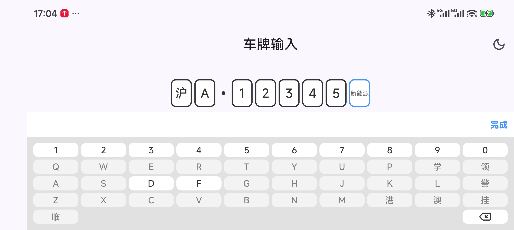

# license_plate_number

[](https://img.shields.io/pub/v/license_plate_number)

#### 文档语言: [English](README.md) | [中文简体](README_CN.md) 

Flutter 车牌号输入组件，包含一个输入框和一个键盘。

- 支持自定义主题，自带黑暗和明亮两个默认主题
- 键盘支持横屏展示
- 内部处理了 Android 返回键的监听，点击返回键隐藏键盘
- 车牌号可选中单个号码进行修改
- 数据驱动的多制式车牌，内置中国、韩国、美国、日本四种模式






## 使用说明

### 安装

```yaml
dependencies:
  license_plate_number: ^2.1.0
```

### 基本用法

Package 包含两个主要的组件，`PlateInputField`  和 `PlateKeyboard` 。

车牌号输入框`PlateInputField` 可以作为一个普通的 Widget 使用：

```dart
Container(
  alignment: Alignment.center,
  child: PlateInputField(
    placeHolder: '沪A12345', // 初始值
    styles: PlateStyles.light, // 主题
    inputFieldWidth: 40,     // 单个输入框宽度
    inputFieldHeight: 54,    // 单个输入框高度
    autoCompleteLength: 7,   // 输满 7 位自动完成，新能源 8 位车牌可设为 8
    onChanged: (List<String> array, String value) {
      // 监听输入内容
      // array ['沪', 'A', '1', '2', '3', '4', '5']
      // value 沪A12345
    },
  ),
)
```

`PlateKeyboard` 不直接使用，键盘的弹出与内容切换，由 `PlateInputField` 在内部控制，如果要在外部控制键盘的弹出与隐藏，可通过 `KeyboardController` 实现。

```dart
/// 定义 KeyboardController
KeyboardController _keyboardController = KeyboardController();

/// 弹出键盘
_keyboardController.showKeyboard(context);

/// 隐藏键盘
_keyboardController.hideKeyboard();

/// 判断键盘是否可见
_keyboardController.isKeyboardShowing();

/// 修改车牌号
_keyboardController.plateNumber = 'XXXXXXX';

/// 清空车牌号
_keyboardController.clear();

/// 读取车牌号字符数组
List<String> characters = _keyboardController.characters;
```

```dart
PlateInputField(
  /// 设置 KeyboardController
  keyboardController: _keyboardController,
  /// 可选：普通 7 位车牌输满 7 位自动完成
  autoCompleteLength: 7,
  /// 可选：按键触感反馈
  enableHapticFeedback: true,
  /// 可选：点击输入框空白区域收起键盘
  dismissOnTapOutside: true,
  /// 可选：自定义完成按钮文字
  completeText: '完成',
  /// 可选：监听每个按键（退格为空字符串）
  onKeyPressed: (key) => print(key),
);
```

注意：`dismissOnTapOutside` 仅覆盖输入框自身区域。如需点击页面任意空白处收起键盘，
请在页面层包一层 `GestureDetector` 调用 `KeyboardController.hideKeyboard`（见示例工程）。
其他可选参数：`newEnergyPlaceHolder`、`semanticsLabel`、`pattern`。

键盘规则：第 8 位（新能源）仅允许字母 D/F 和数字；特殊后缀键（学/领/警/港/澳/挂/临）
仅在普通车牌最后一位可用；省份页同时提供军车字头（军/空/海/北/沈/兰/济/南/广/成）。

自定义模式：键盘布局与每槽位规则由 `PlatePattern`（槽位、键盘页、分隔符）描述，
内置 `PlatePatterns.china` 为默认模式，可通过 `PlateInputField` 的 `pattern:` 参数切换。
内置模式：`PlatePatterns.china`（中国）、`PlatePatterns.korea`（韩国）、
`PlatePatterns.unitedStates`（美国通用宽松模式）、`PlatePatterns.japan`
（日本两行布局，基于 `displayRows` 多行分组）。


### 定制外观

组件内置了两款默认主题，同时支持自定义主题。

```dart
/// 方式一，使用构造函数
PlateStyles(
  /// 车牌号字体样式
  plateInputFieldTextStyle: TextStyle(
    color: Color(0xFFFFFFFF),
    fontSize: 20,
    fontWeight: FontWeight.normal,
  ),
  /// Text style of new energy place holder.
  newEnergyPlaceHolderTextStyle: TextStyle(
    color: Color(0xFFDDDDDD),
    fontSize: 10,
    fontWeight: FontWeight.normal,
  ),
  /// 输入框背景
  plateInputFieldColor: Color(0xFF4A4A4A),
  /// 输入框边框
  plateInputBorder: Border.fromBorderSide(BorderSide(
    color: Color(0xFFFFFFFF),
    width: 2,
    style: BorderStyle.solid,
  )),
  /// 输入框获取焦点时的边框
  plateInputFocusedBorder: Border.fromBorderSide(BorderSide(
    color: Color(0xFF2196F3),
    width: 2,
    style: BorderStyle.solid,
  )),
  /// 输入框边框圆角半径
  plateInputBorderRadius: const Radius.circular(8.0),
  /// 省市与号码之间分隔符的颜色
  plateSeparatorColor: Color(0xFFFFFFFF),
  
  /// 键盘背景色
  keyboardBackgroundColor: Color(0xFF131313),
  /// 键盘按钮字体颜色
  keyboardButtonTextColor: Color(0xFFFFFFFF),
  /// 键盘按钮背景色
  keyboardButtonColor: Color(0xFF4A4A4A),
  /// 键盘按钮不可用时的背景色
  keyboardButtonDisabledColor: Color(0x994A4A4A),
);
```

```dart
/// 方式二，使用默认主题替换
PlateStyles.dark.copyWith(
  keyboardBackgroundColor: Color(0xFF000000),
);
```

